# Warden — stages walkthrough

Local notes from the build sessions. Use this to recall **what each stage does**, **how it fits**, and a **Mermaid diagram** per stage. Expand sections as you revisit stages in chat (`expand N`).

**End product:** a local-first CLI (`warden`) that turns a code change into an evidence-backed review report (Markdown/JSON), can score itself (`warden eval`), and can dry-run or publish **COMMENT**-only GitHub PR reviews (`warden github review`). It does not approve, merge, push, or rewrite source by default.

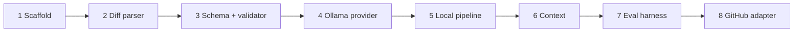

| # | Stage | One line |
|---|--------|----------|
| 1 | Scaffold | Installable package, CLI entry, config templates, tests layout |
| 2 | Diff parser | Unified/git diff → files, hunks, old/new line numbers |
| 3 | Schema + validator | Strict findings; drop anything not backed by the diff |
| 4 | Ollama provider | Local LLM chat over HTTP with mocked tests |
| 5 | Local review pipeline | `warden review`: diff → model → validate → Markdown/JSON |
| 6 | Context gathering | Surrounding lines + symbol search into the prompt |
| 7 | Evaluation harness | `warden eval` scores labeled fixture diffs |
| 8 | GitHub adapter | Fetch PR, same engine, dry-run; `--publish` COMMENT only |

**Not done in this walkthrough yet:** Bitbucket, OpenAI-compatible provider, local UI, GitHub Actions / self-hosted runner, reliability issue 001 (prompts / deterministic checks).

---

## Stage 1 — Scaffold

**Commit:** `ad70a67` (2026-10-28, saroj990)  
**What:** Empty shell of the product — no real reviewing yet.

| Piece | Role |
|--------|------|
| `pyproject.toml` | Package, Python 3.11+, deps, `warden` script, pytest/ruff |
| `src/pr_review/` | Library package + early CLI |
| `tests/unit/` | Test home + first CLI smoke tests |
| `README.md` | Goal, setup, roadmap |
| `.env.example` / `config.example.toml` | Safe templates (secrets out of git) |
| `.gitignore` + Cursor rules | Local hygiene; one feature per branch |

**Why:** `pip install -e ".[dev]"` and `warden --help` / `doctor` work before Ollama or GitHub exist.

**Does not:** parse diffs, call a model, publish findings.

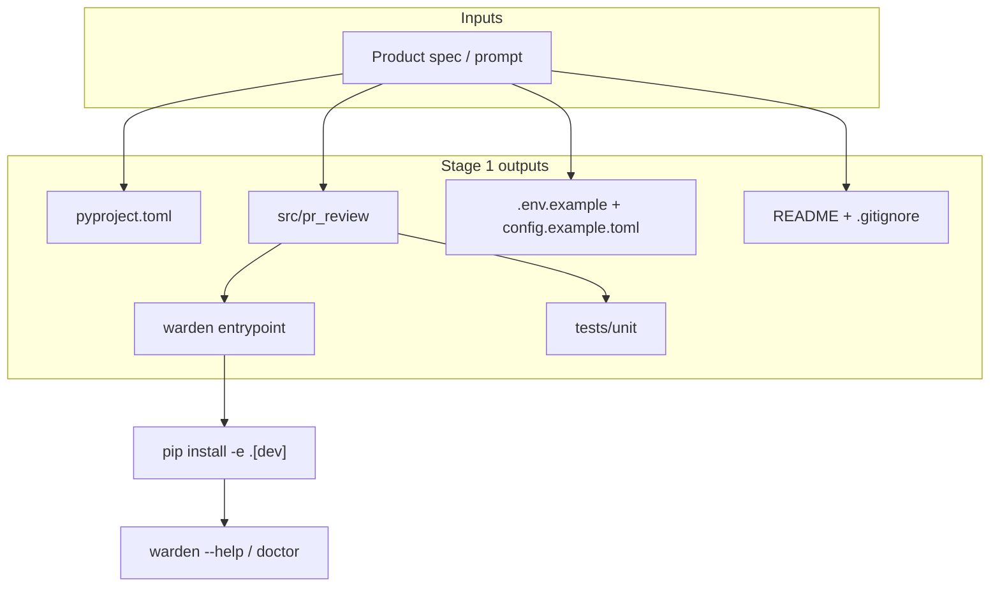

---

## Stage 2 — Diff parser

**Where:** `src/pr_review/git/diff.py`, `repository.py`  
**What:** Turn opaque unified/git diff text into a typed tree so later stages can say “file X, line Y.”

### Internals

1. **Optional fetch** — `collect_diff` runs read-only `git diff` (`base` vs work tree, or `base...head`); returns raw text + label.
2. **`parse_unified_diff`** — walk lines with regexes for `diff --git`, modes, rename/copy, binary, `---/+++`, `@@` hunks.
3. **Line mapping** — ` ` context (old+new), `+` add (new only), `-` delete (old only); counters from hunk headers.
4. **Structure** — `ParsedDiff` → `FileDiff` → `Hunk` → `DiffLine` (`path` prefers new path).
5. **`is_inline_commentable`** — true only for add/context on the new file (not deletes/binary/deleted files). Used by validator and GitHub comments.

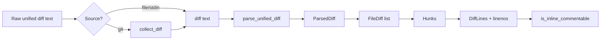

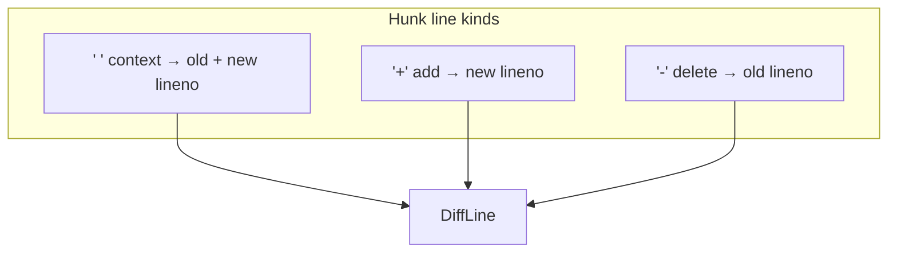

---

## Stage 3 — Finding schema + validator

**Commit:** `a9cd47f` (merged PR #1)  
**Where:** `src/pr_review/models.py`, `review/validator.py`  
**What:** Stage 3 does **not** review code by itself. Stage 2 produces a `ParsedDiff`; Stage 3 defines **what a finding must look like** and **which model claims may be published**.

### Part A — Schema (`models.py`)

Pydantic models are the contract between the model, the pipeline, and reports:

| Type | Role |
|------|------|
| `Finding` | Severity, category, file, line (for inline), title, problem, scenario, suggestion, evidence, fingerprint, `location_kind` |
| `Evidence` | File, start/end line, excerpt (non-empty text) |
| `ReviewReport` | Summary, findings, checks, limitations, scope — Markdown/JSON and GitHub planning |

`finding_with_fingerprint` can **hash** title/problem/file/line/category into a stable **fingerprint** when the model omits it (dedupe in the validator; “already posted” on GitHub).

Schema validation only checks **shape** (types, required fields, inline findings must have a line). It does **not** prove the defect is real.

### Part B — Validator (`validator.py`)

`validate_findings(candidates, parsed_diff)` runs each `Finding` against the **same** `ParsedDiff` from Stage 2:

| Check | Purpose |
|--------|---------|
| Paths do not escape repo (`../`, absolute) | Safety |
| File appears in the diff | No claims on untouched files |
| Evidence excerpts match real hunk line text | No invented code |
| Inline `line` is `is_inline_commentable` | Anchors match new-file / GitHub rules |
| problem / scenario / suggestion non-empty | No hollow findings |
| Duplicate fingerprint | Only first copy accepted |

Rejections **do not** appear in `findings`; reasons are often listed under **Limitations** in the report (e.g. `Rejected "…": evidence excerpt is not present in the diff`).

**Excerpt quirk:** the model sometimes pastes prompt line numbers (`3|    return …`). `_strip_prompt_line_prefix` removes that prefix before comparing to diff line content.

### Pipeline position

```text
Stage 2: diff text → ParsedDiff
Stages 4–5: model → JSON candidates
Stage 3: candidates + ParsedDiff → accepted findings → ReviewReport
```

Stage 8 (GitHub) maps only **accepted** inline findings to PR comments.

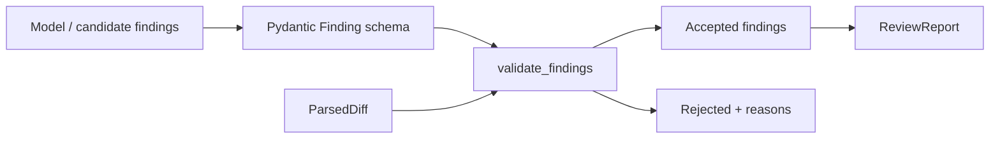

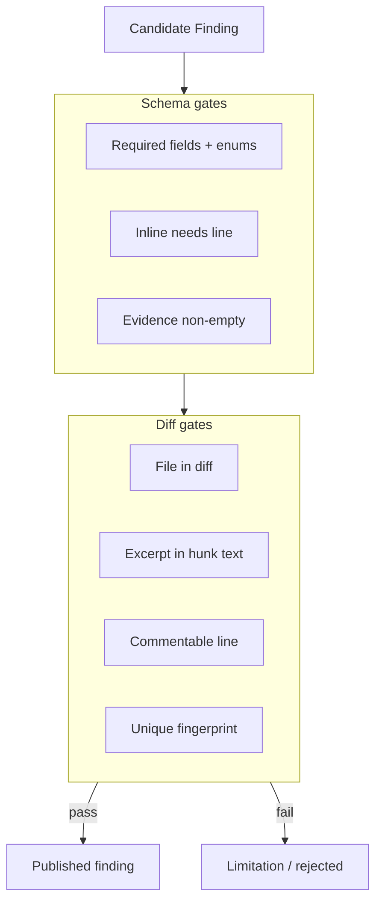

---

## Stage 4 — Ollama provider

**Commit:** `17969f1` (merged PR #2)  
**Where:** `src/pr_review/providers/base.py`, `ollama.py`, `tests/unit/test_ollama_provider.py`

### Summary

Stage 4 adds the **first real brain hook**: a small **`LLMProvider`** interface so the review pipeline does not depend on Ollama internals. **`OllamaProvider`** talks to a local Ollama server over HTTP (`httpx`):

- **`chat`** → `POST /api/chat` with system + user messages, `stream: false`, configurable **timeout** → assistant text + timing/metadata.
- **`check_connection`** → `GET /api/tags` lists installed models **without** running inference (used for health-style checks).

Failures are **typed** (`ProviderConnectionError`, `ProviderTimeoutError`, `ProviderResponseError`) so the CLI can distinguish “Ollama down” from “bad JSON from the model.” Unit tests use **mocked HTTP** so CI passes without a live Ollama.

**Does not:** choose prompts, parse findings, or validate evidence — that is Stages 5 and 3. **OpenAI-compatible** provider is named in config but not implemented yet.

### Internals (short)

1. Pipeline builds `list[ChatMessage]` (roles: system, user, optional retry user).
2. `OllamaProvider.chat(messages, model=…, timeout_seconds=…)` POSTs JSON to `/api/chat`.
3. Response body is parsed; assistant `content` string goes to `parse_model_document` (Stage 5).
4. Config: `OLLAMA_BASE_URL`, model name from env/config/CLI; default base `http://127.0.0.1:11434`.

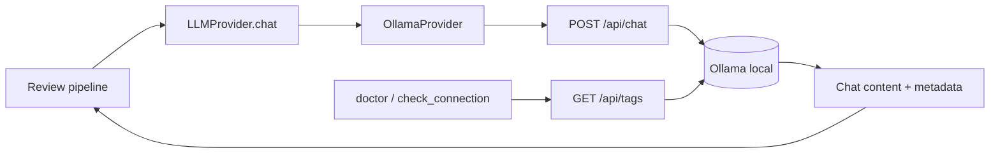

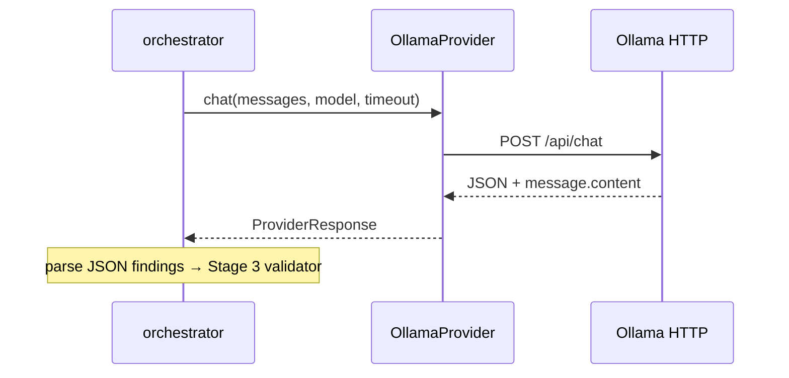

---

## Stage 5 — Local review pipeline

**Where:** `review/orchestrator.py`, `chunking.py`, `prompts.py`, `parse_output.py`, `reporters/`, `cli.py`  
**What:** `warden review` loads a diff (git or file), chunks if needed, prompts the model, parses JSON, validates against the diff, writes Markdown/JSON. No findings ≠ “bug-free.”

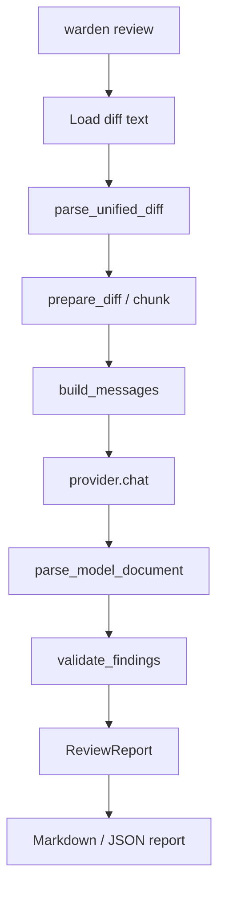

---

## Stage 6 — Context gathering

**Where:** `context/loader.py`, `context/search.py`  
**What:** When a work tree exists, load surrounding lines around changed hunks and optionally `git grep` for symbols added in the diff. Context is for reasoning only; published findings still need diff evidence.

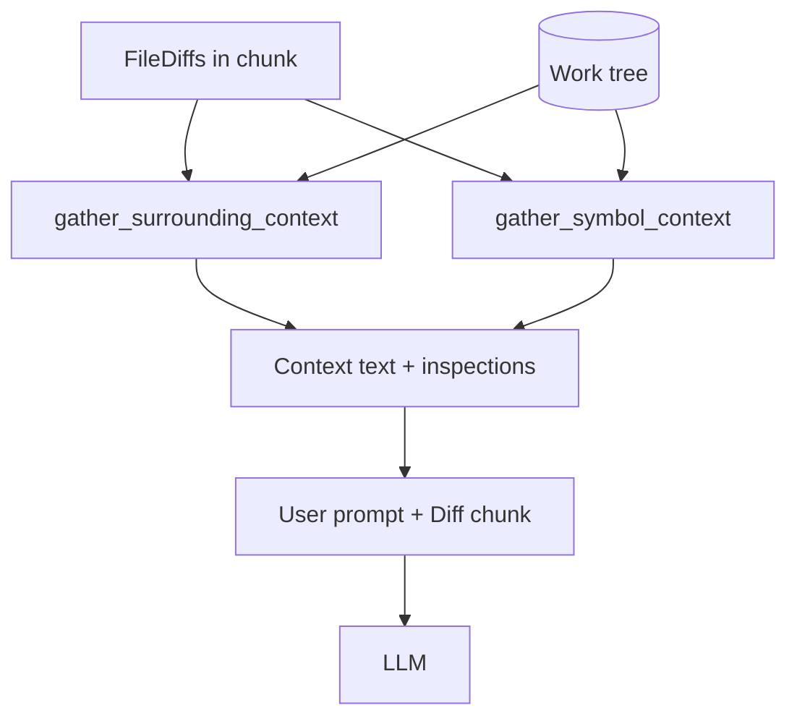

---

## Stage 7 — Evaluation harness

**Where:** `eval/` + `tests/fixtures/eval/`  
**What:** `warden eval` runs the pipeline on labeled cases (defect / clean / suppress), scores matches, exits non-zero when labels fail. Results depend on model and config.

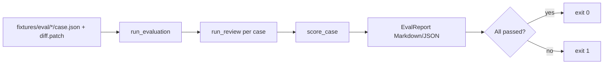

---

## Stage 8 — GitHub adapter

**Where:** `integrations/github.py`, `comments.py`, `review_pr.py`, CLI `github review`  
**What:** Fetch PR metadata + diff with `GITHUB_TOKEN`, run the same engine (context off for fixture-like PR diffs), map findings to COMMENT plan. Default dry-run; `--publish` posts summary + inline comments only (no approve/merge). Skips non-commentable lines and duplicate fingerprints.

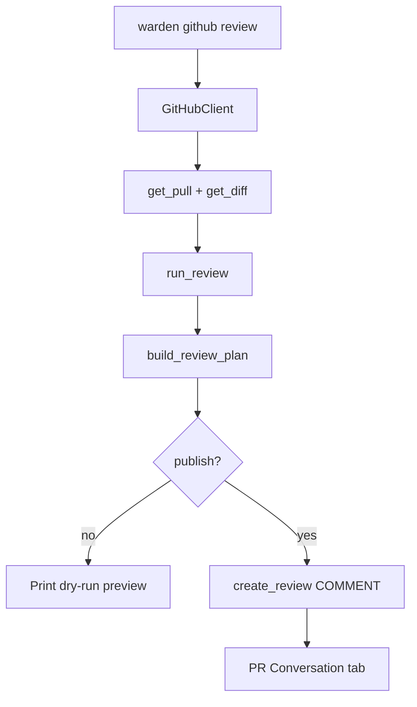

---

## How to use this doc in later sessions

1. Ask **expand N** for a deeper walkthrough of stage N (internals, files, edge cases).
2. After that stage is covered, append a short **Session summary** under that stage (date + 3–5 bullets).
3. Keep Mermaid diagrams in sync if behavior changes.

### Session log

| Date | Stages covered | Notes |
|------|----------------|--------|
| 2026-03-25 | 1–2 detailed; 3–8 short + diagrams | Scaffold + diff parser internals; doc created with Mermaid per stage |
| 2026-03-26 | 3 expanded; 4 summarized + sequence diagram | Schema vs validator; Ollama provider flow |
