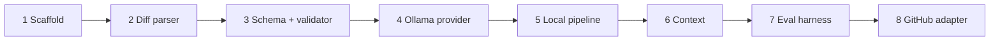
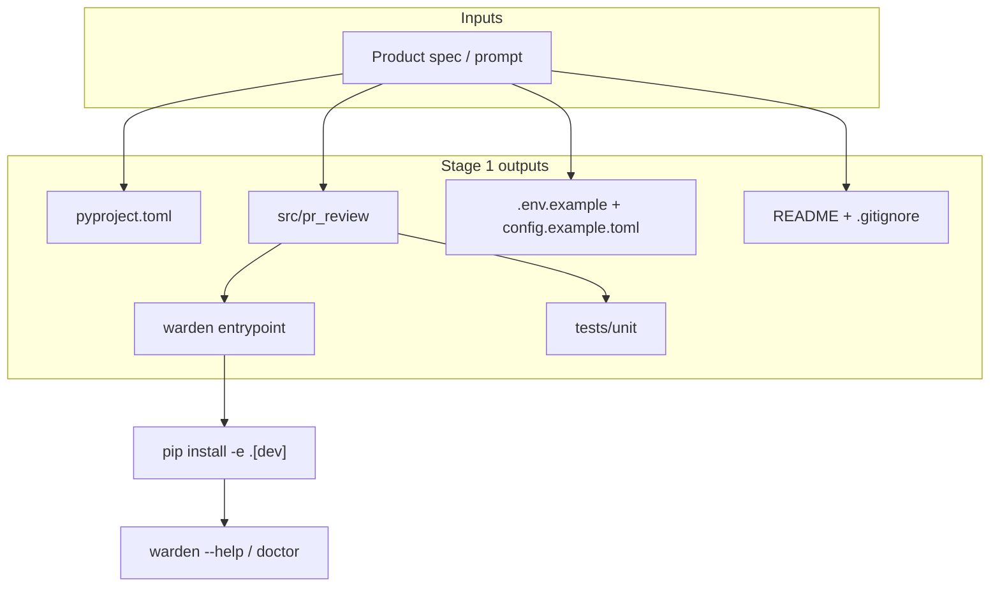
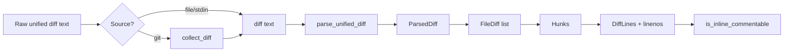
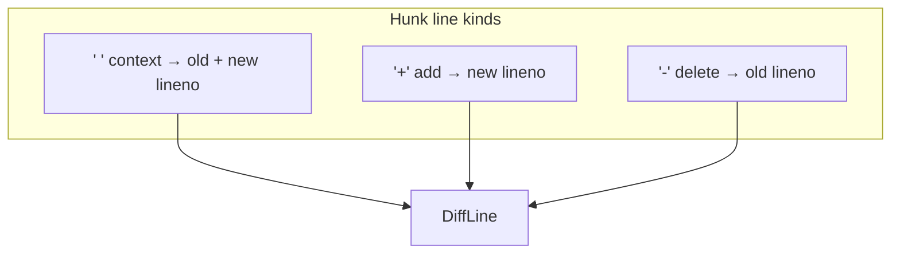
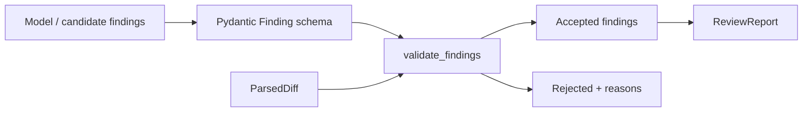
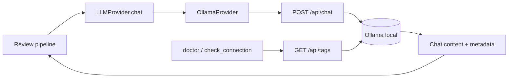
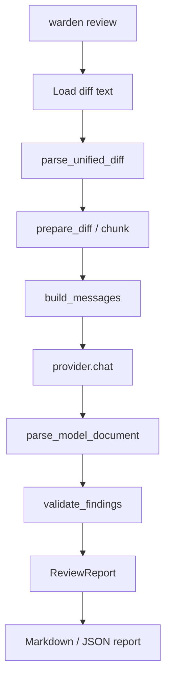
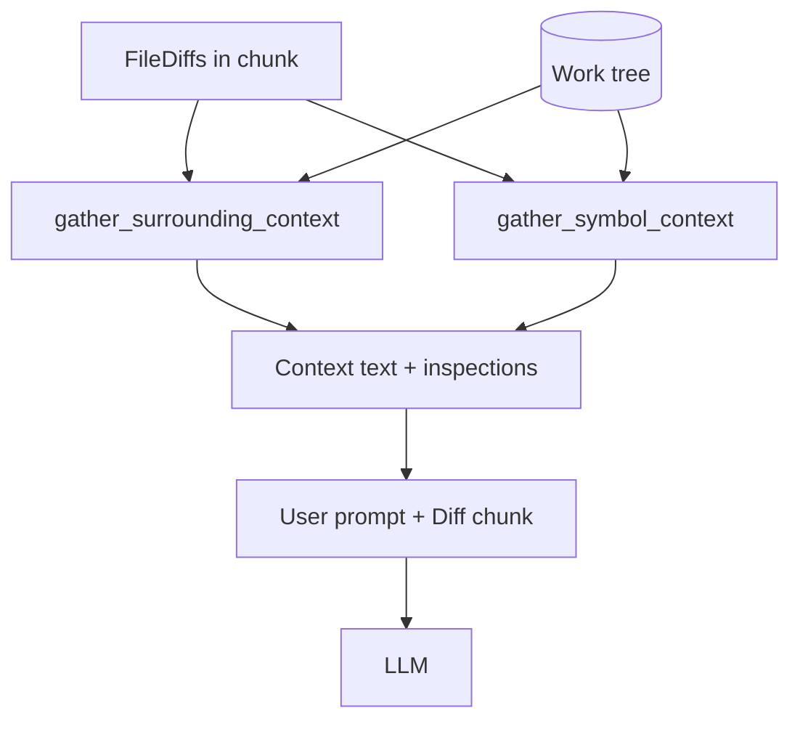
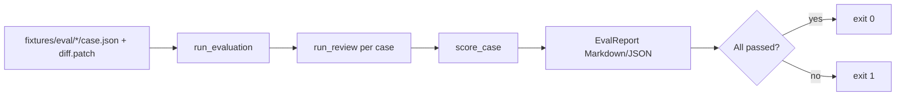
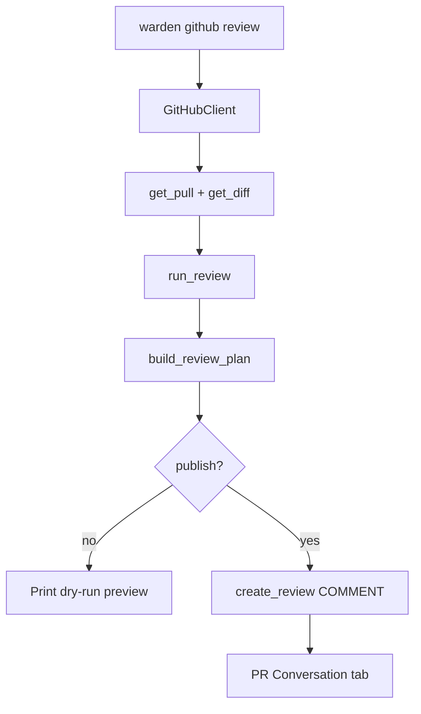

# Warden — stages walkthrough

Local notes from the build sessions. Use this to recall **what each stage does**, **how it fits**, and a **Mermaid diagram** per stage. Expand sections as you revisit stages in chat (`expand N`).

**End product:** a local-first CLI (`warden`) that turns a code change into an evidence-backed review report (Markdown/JSON), can score itself (`warden eval`), and can dry-run or publish **COMMENT**-only GitHub PR reviews (`warden github review`). It does not approve, merge, push, or rewrite source by default.

| # | Stage | One line |
|---|--------|----------|
| 1 | Scaffold | Installable package, CLI entry, config templates, tests layout |
| 2 | Diff parser | Unified/git diff → files, hunks, old/new line numbers |
| 3 | Schema + validator | Strict findings; drop anything not backed by the diff |
| 4 | Ollama provider | Local LLM chat over HTTP with mocked tests |
| 5 | Local review pipeline | `warden review`: diff → model → validate → Markdown/JSON |
| 6 | Context gathering | Surrounding lines + symbol search into the prompt |
| 7 | Evaluation harness | `warden eval` scores labeled fixture diffs |
| 8 | GitHub adapter | Fetch PR, same engine, dry-run; `--publish` COMMENT only |

**Not done in this walkthrough yet:** Bitbucket, OpenAI-compatible provider, local UI, GitHub Actions / self-hosted runner, reliability issue 001 (prompts / deterministic checks).

---

## Stage 1 — Scaffold

**Commit:** `ad70a67` (2026-10-28, saroj990)  
**What:** Empty shell of the product — no real reviewing yet.

| Piece | Role |
|--------|------|
| `pyproject.toml` | Package, Python 3.11+, deps, `warden` script, pytest/ruff |
| `src/pr_review/` | Library package + early CLI |
| `tests/unit/` | Test home + first CLI smoke tests |
| `README.md` | Goal, setup, roadmap |
| `.env.example` / `config.example.toml` | Safe templates (secrets out of git) |
| `.gitignore` + Cursor rules | Local hygiene; one feature per branch |

**Why:** `pip install -e ".[dev]"` and `warden --help` / `doctor` work before Ollama or GitHub exist.

**Does not:** parse diffs, call a model, publish findings.

---

## Stage 2 — Diff parser

**Where:** `src/pr_review/git/diff.py`, `repository.py`  
**What:** Turn opaque unified/git diff text into a typed tree so later stages can say “file X, line Y.”

### Internals

1. **Optional fetch** — `collect_diff` runs read-only `git diff` (`base` vs work tree, or `base...head`); returns raw text + label.
2. **`parse_unified_diff`** — walk lines with regexes for `diff --git`, modes, rename/copy, binary, `---/+++`, `@@` hunks.
3. **Line mapping** — ` ` context (old+new), `+` add (new only), `-` delete (old only); counters from hunk headers.
4. **Structure** — `ParsedDiff` → `FileDiff` → `Hunk` → `DiffLine` (`path` prefers new path).
5. **`is_inline_commentable`** — true only for add/context on the new file (not deletes/binary/deleted files). Used by validator and GitHub comments.

---

## Stage 3 — Finding schema + validator

**Where:** `src/pr_review/models.py`, `review/validator.py`  
**What:** Define a strict finding/report shape; accept only findings that cite real paths, commentable lines, and excerpts that appear in the diff (duplicates rejected by fingerprint).

---

## Stage 4 — Ollama provider

**Where:** `src/pr_review/providers/` (`base.py`, `ollama.py`)  
**What:** Provider abstraction + Ollama `/api/chat` (and tags for connectivity). Timeouts and HTTP errors become typed provider errors. Unit tests mock HTTP so CI needs no live Ollama.

---

## Stage 5 — Local review pipeline

**Where:** `review/orchestrator.py`, `chunking.py`, `prompts.py`, `parse_output.py`, `reporters/`, `cli.py`  
**What:** `warden review` loads a diff (git or file), chunks if needed, prompts the model, parses JSON, validates against the diff, writes Markdown/JSON. No findings ≠ “bug-free.”

---

## Stage 6 — Context gathering

**Where:** `context/loader.py`, `context/search.py`  
**What:** When a work tree exists, load surrounding lines around changed hunks and optionally `git grep` for symbols added in the diff. Context is for reasoning only; published findings still need diff evidence.

---

## Stage 7 — Evaluation harness

**Where:** `eval/` + `tests/fixtures/eval/`  
**What:** `warden eval` runs the pipeline on labeled cases (defect / clean / suppress), scores matches, exits non-zero when labels fail. Results depend on model and config.

---

## Stage 8 — GitHub adapter

**Where:** `integrations/github.py`, `comments.py`, `review_pr.py`, CLI `github review`  
**What:** Fetch PR metadata + diff with `GITHUB_TOKEN`, run the same engine (context off for fixture-like PR diffs), map findings to COMMENT plan. Default dry-run; `--publish` posts summary + inline comments only (no approve/merge). Skips non-commentable lines and duplicate fingerprints.

---

## How to use this doc in later sessions

1. Ask **expand N** for a deeper walkthrough of stage N (internals, files, edge cases).
2. After that stage is covered, append a short **Session summary** under that stage (date + 3–5 bullets).
3. Keep Mermaid diagrams in sync if behavior changes.

### Session log

| Date | Stages covered | Notes |
|------|----------------|--------|
| 2026-03-25 | 1–2 detailed; 3–8 short + diagrams | Scaffold + diff parser internals; doc created with Mermaid per stage |
